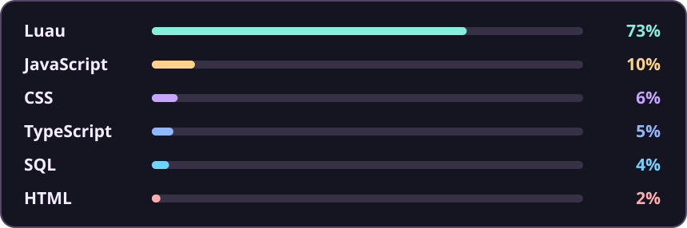

  

<h1 align="center">Full-stack programmer</h1>

  <a href="#skills">Skills</a> &nbsp;·&nbsp;
  <a href="#most-used-languages">Languages</a> &nbsp;·&nbsp;
  <a href="#contacts">Contacts</a>

I build web apps from the user interface through to the APIs and database. I also build Roblox experiences in Luau, working on gameplay, UI, and the server systems that handle progression and save player data.

## Skills

| Area | What I work with |
| --- | --- |
| **Web frontend** | JavaScript, TypeScript, HTML, CSS, React, Next.js, Vite, and Tailwind CSS |
| **Backend & data** | Node.js, API integrations, OAuth, SQL, PostgreSQL, Supabase, and Prisma |
| **Roblox & Luau** | Luau, Roblox Studio, Rojo, client and server scripting, gameplay systems, UI, progression, and player data |
| **Development tools** | Git, GitHub, and VS Code |

## Most Used Languages

## Contacts

- 💬 **Discord** · `sxwvvykng`
- 🎮 **Roblox** · [SxwvvyKNG](https://www.roblox.com/users/3221852843/profile)
- ✉️ **Email** · [sawvvygme3@gmail.com](mailto:sawvvygme3@gmail.com)
